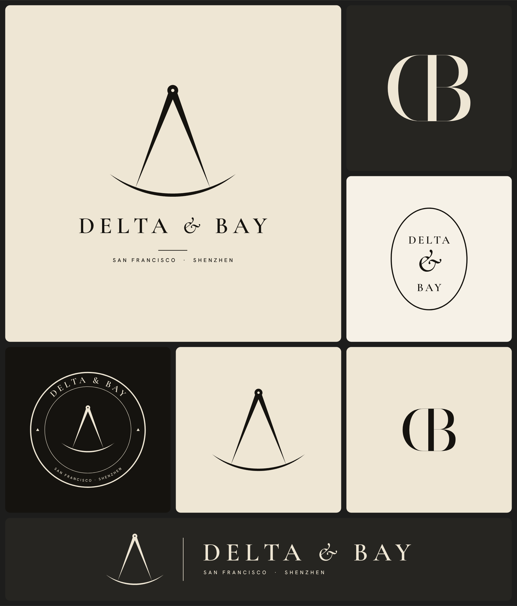

# Delta & Bay: identity



## The idea

The emblem is a pair of navigator's dividers, the tool used on a chart to measure the distance between two ports.

- **Delta:** the open legs form a Δ. It stands for change, and for the Pearl River Delta that Shenzhen sits in.
- **Bay:** the arc the points sweep is a bay. It stands for the San Francisco Bay Area and the Greater Bay Area around Shenzhen.
- **The club:** the dividers are an instrument of precision and the arc is a route between two harbours. That's the club: engineering, manufacturing and the trip from one bay to the other.

Everything is flat solid ink on parchment, with no gradients, shadows or 3D. Every file is an outlined vector, so it needs no fonts installed and scales from a 16px favicon to a building sign.

## The marks

| Mark | Use it for | Files |
|---|---|---|
| **Vertical lockup** (emblem, name, cities) | Primary logo: website header on mobile, invitations, letterhead, merch | `svg/delta-and-bay-lockup-vertical.svg` |
| **Horizontal lockup** | Website header, email signature, decks, anywhere wide and short | `svg/delta-and-bay-lockup-horizontal.svg` |
| **Emblem** (dividers alone) | Favicon, app icon, social avatar, embossing, pin badges | `svg/delta-and-bay-mark.svg` |
| **Wordmark** | When the emblem already appears nearby | `svg/delta-and-bay-wordmark.svg` |
| **Monogram** (mirrored D sharing a stem with B) | Signet: wax seal, cufflinks, napkins, room keys, the back of a card | `svg/delta-and-bay-monogram.svg` |
| **Oval seal** | Stickers, menus, stationery, packaging closures | `svg/delta-and-bay-seal.svg` |
| **Roundel** | Membership cards, coasters, stamps, embroidered patches | `svg/delta-and-bay-roundel.svg` |

Each mark comes in ink (`*.svg`) and parchment for dark backgrounds (`*-reverse.svg`), with transparent 2400px PNGs of both in `png/`. Ready-made 1080px square avatars are in `social/` and survive a circular crop.

## Colour

| Name | Hex | Role |
|---|---|---|
| Ink | `#15130F` | All marks and text |
| Parchment | `#EEE6D4` | Primary background; reverse marks |
| Ivory | `#F6F1E7` | Lighter paper stock, seal backgrounds |
| Graphite | `#262521` | Dark surfaces |

Navy palettes under consideration (Two Bays, Celadon, Fog & Brass) are compared in [palette-options.png](palette-options.png). The table above stays in force until one is chosen.

Use one ink colour per application. If you print on textured cream stock, print in ink (or a single black Pantone) and let the paper supply the parchment.

## Type

| Role | Typeface | Setting |
|---|---|---|
| Name | Cormorant Garamond SemiBold | All caps, tracked +200 |
| Ampersand | Cormorant Garamond Medium Italic | Same size as the caps |
| Monogram only | Bodoni Moda (96pt optical size) | Never for running text |
| Small lines (cities, labels) | Hanken Grotesk Medium | All caps, tracked +340, small |

All are free Google Fonts under the SIL Open Font License, so they're fine for commercial use, including in the logo.

## Rules

- **Clear space:** keep at least the height of the "D" in the name clear on every side.
- **Minimum sizes:**
  - Emblem and monogram: 16px / 5mm.
  - Vertical lockup: 300px / 50mm wide.
  - Horizontal lockup: 480px / 80mm wide.
  - Seal: 25mm. Roundel: 40mm.
  - Below these sizes the city line stops being readable, so use the wordmark or the emblem alone.
- **Don't** stretch, rotate, outline, add effects, recolour outside the palette, or retype the name in a live font. Use the files.
- **Avoid "ΔB":** don't pair the Greek letters as initials. To a US audience it reads as a fraternity.

## Before you rely on it

- **Trademarks:** dividers and compasses are common motifs, so run a clearance search before printing anything expensive. Search the name and the emblem in the US (USPTO), the UK (UKIPO) and China (CNIPA).
- **File in China early:** China is first-to-file, and squatters watch for foreign brands operating there.

## Regenerating

The marks are drawn in code, so you change them by editing parameters, not by hand.

```bash
cd brand/src
pip install -r requirements.txt
./fetch-fonts.sh          # downloads the four OFL fonts into src/fonts
python3 build.py          # writes svg/, social/, board.svg
node export-png.mjs       # writes png/, social/*.png, board.png (needs playwright)
```

`mark()` in `build.py` holds the emblem's geometry: leg angle, leg width, hinge size and how far the arc overshoots the points.
