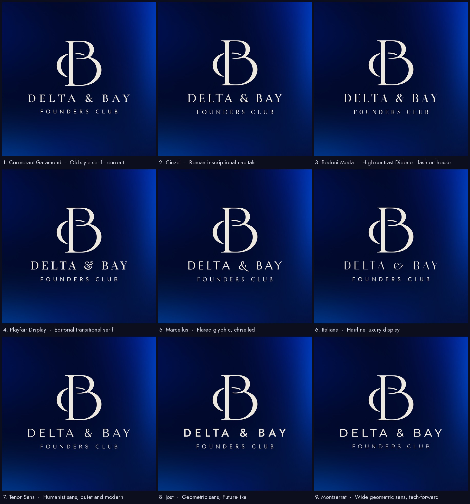

# Delta & Bay Founders Club: brand

The logo is the curved "crescent + B" monogram from concept 2 (`concepts/identity-concept.webp`), set on Prussian blue from concept 1 (`concepts/colour-concept.webp`).

## Files

All SVGs are pure vector outlines: no fonts, no embedded images. They scale to any size and open in Figma, Illustrator, Canva or a browser. The PNGs are 2048 × 2048 renders of the same files.

| File (`logo/svg/`, same name in `logo/png/`) | Use it for |
|---|---|
| `delta-and-bay-logo.svg` | Full lockup on Prussian blue: monogram, name, tagline and cities. Decks, cover slides, social posts. |
| `delta-and-bay-logo-compact.svg` | Monogram, name and "Founders Club" on Prussian blue. Headers, email signatures, documents. |
| `delta-and-bay-monogram.svg` | Monogram only on Prussian blue. Profile pictures, favicons, app icons, stamps. |
| `*-ivory-transparent.svg` | Ivory artwork with no background, for photos or other dark backgrounds. |
| `*-prussian-transparent.svg` | Prussian blue artwork with no background, for white or light backgrounds. |

## Colours

| | Hex | RGB |
|---|---|---|
| Prussian blue (background) | `#050A30` | 5, 10, 48 |
| Ivory (logo) | `#ECE8E0` | 236, 232, 224 |

Ivory is the logo colour sampled from concept 2. For pure white instead, change `fill="#ECE8E0"` to `fill="#FFFFFF"` in the SVG.

## Typefaces

Both are free on Google Fonts, so the website and decks can match the logo.

| Line | Typeface | Weight | Letter-spacing |
|---|---|---|---|
| DELTA & BAY | Cormorant Garamond | 600 (SemiBold) | 0.27em |
| FOUNDERS CLUB | Josefin Sans | 350 | 0.50em |
| BRIDGING FRONTIERS | Josefin Sans | 380 | 0.36em |
| SAN FRANCISCO — SHENZHEN | Josefin Sans | 380 | 0.26em |

All lines are set in capitals.

## Typeface exploration (choosing now)

A shorter lockup is being considered: the monogram, "DELTA & BAY" and "FOUNDERS CLUB", with an optional small "sz.sf" line underneath. `explorations/typefaces/` shows it in nine typefaces. Every option uses the same curved monogram on Prussian blue with an edge glow.

| # | DELTA & BAY | FOUNDERS CLUB and sz.sf | Feel |
|---|---|---|---|
| 1 | Cormorant Garamond 600 | Josefin Sans 400 | Old-style serif (current logo) |
| 2 | Cinzel 500 | Cinzel 500 | Roman inscriptional capitals |
| 3 | Bodoni Moda 500 | Bodoni Moda 500 | High-contrast Didone, fashion house |
| 4 | Playfair Display 500 | Lato 400 | Editorial serif |
| 5 | Marcellus | Marcellus | Flared, chiselled |
| 6 | Italiana | Jost 400 | Hairline luxury |
| 7 | Tenor Sans | Tenor Sans | Humanist sans, quiet and modern |
| 8 | Jost 500 | Jost 400 | Geometric sans, Futura-like |
| 9 | Montserrat 500 | Montserrat 400 | Wide geometric sans, tech-forward |

- `explorations/typefaces/svg/<name>.svg` includes the sz.sf line, and `<name>-no-szsf.svg` leaves it out.
- `sheet.jpg` and `sheet-with-szsf.jpg` show all nine side by side.
- Cinzel has no lowercase, so its sz.sf comes out as small capitals.

**Edge glow.** The glow is copied from the Prussian blue panel in concept 1: brighter electric blue at the top-right corner, down the right edge and along the bottom-left. It's built from six vector radial gradients fitted to that panel, so it stays sharp at any size and needs no embedded image. It matches the panel's colours to within about 1.4/255 on average.

## How it was made

- **Monogram:** traced from the concept image. Three copies of the logo in concept 2 were aligned to a fraction of a pixel and averaged to remove compression noise, then traced into smooth Bézier curves. Against the source it matches to within about 1/16 of a source pixel. A review pass then smoothed out small ripples that only showed at very large sizes; the shape is otherwise unchanged (99.5% overlap).
- **Clean outlines:** overlapping letter shapes are merged, so strokes, outlines and boolean operations in Figma or Illustrator work as expected.
- **Text:** reset in the matching fonts rather than traced, because the source letters are only 10–20 px tall. Weight, size, letter-spacing and line positions were fitted to the concept, so the layout is the same.
- **Two small corrections:**
  - In the concept, the text block sat about 3–5 px to the right of the monogram. Every line is now centred on the monogram.
  - Josefin Sans's "Z" has a decorative hook that the concept doesn't, so it was swapped for a plain Z.
