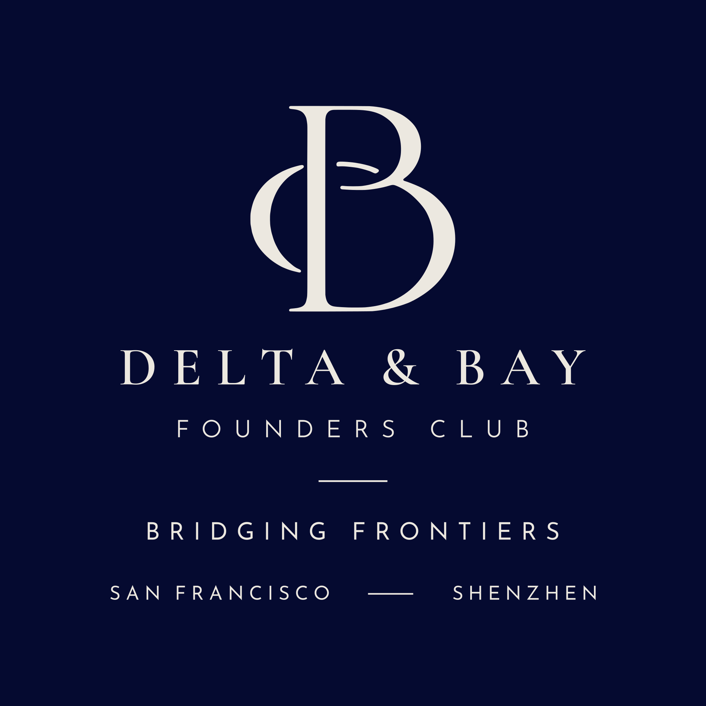

# Delta & Bay Founders Club: brand

The logo has two parts:
- **Monogram:** the curved "crescent + B" from concept 2 (`concepts/identity-concept.webp`).
- **Lettering:** "DELTA & BAY" and "FOUNDERS CLUB" in Montserrat.

It sits on Prussian blue with the edge glow from concept 1 (`concepts/colour-concept.webp`).

## Files

All SVGs are pure vector outlines: no fonts, no embedded images. They scale to any size and open in Figma, Illustrator, Canva or a browser. Every SVG has a matching PNG in `logo/png/`: 2048 px wide, except the LinkedIn logo, which is 400 × 400 and ready to upload.

| File (`logo/svg/`) | Use it for |
|---|---|
| `delta-and-bay-logo.svg` | **Main logo.** Monogram and name on Prussian blue with the edge glow (square). Social posts, cover slides, profile banners. |
| `delta-and-bay-logo-flat.svg` | The same on plain Prussian blue, for print or anywhere the glow is too busy. |
| `delta-and-bay-logo-ivory-transparent.svg` | Ivory logo, tightly cropped, no background. Use it on photos, the website header or dark slides. |
| `delta-and-bay-logo-prussian-transparent.svg` | Prussian blue logo, tightly cropped, no background. Use it on white or light backgrounds. |
| `delta-and-bay-linkedin.svg` | **LinkedIn company logo.** Monogram and "DELTA & BAY" only (no "FOUNDERS CLUB"), on the edge glow, scaled to fill the square so it still reads at LinkedIn's 48–72 px display size. Upload `png/delta-and-bay-linkedin.png`, which is LinkedIn's recommended 400 × 400. A `-flat` version on plain Prussian blue is also included. |
| `delta-and-bay-monogram.svg` | Monogram only, on the edge glow (square). Profile pictures, app icons, favicons. |
| `delta-and-bay-monogram-flat.svg` | Monogram on plain Prussian blue. |
| `delta-and-bay-monogram-*-transparent.svg` | Monogram only, tightly cropped, in ivory or Prussian blue. |

`backgrounds/` holds the edge glow on its own, for slides and the website: `edge-glow-16x9.svg` (1920 × 1080) and `edge-glow-square.svg`.

**Minimum size:** below about 200 px wide, "FOUNDERS CLUB" gets too thin to read. Use the monogram on its own there, for example in avatars and favicons.

## Colours

| | Hex | Where |
|---|---|---|
| Prussian blue | `#050A30` | Background |
| Ivory | `#ECE8E0` | Logo and text on dark backgrounds |
| Glow blue | `#0035B1` | Brightest point of the edge glow (top-right corner) |

To use pure white instead of ivory, change `fill="#ECE8E0"` to `fill="#FFFFFF"` in the SVG.

## Typeface

**Montserrat** for everything: logo, website and decks. It's free on Google Fonts.

| Line | Weight | Size | Letter-spacing |
|---|---|---|---|
| DELTA & BAY | Medium (500) | 1× | 0.28em |
| FOUNDERS CLUB | Regular (400) | 0.49× | 0.45em |

Both lines are in capitals and centred on the monogram.

## Parked alternative

Option 6 was also a favourite: **Italiana** for "DELTA & BAY", with Jost for "FOUNDERS CLUB". It's saved as `explorations/typefaces/svg/italiana-no-szsf.svg`, in case we revisit it.

## Explorations

- `explorations/typefaces/`: the nine typefaces compared, with and without a small "sz.sf" line. `sheet.jpg` shows them side by side.
- `explorations/v1-cormorant-full-lockup/`: the first version, in Cormorant Garamond with "BRIDGING FRONTIERS" and "SAN FRANCISCO — SHENZHEN".

## How it was made

- **Monogram:** traced from concept 2.
  - Three copies of the logo in the concept were aligned to a fraction of a pixel and averaged to remove compression noise, then traced into smooth Bézier curves.
  - It matches the source to within about 1/16 of a source pixel.
- **Edge glow:** fitted to the Prussian blue panel in concept 1.
  - Six vector radial gradients reproduce the panel's colours to within about 1.4/255 on average.
  - That's how it stays sharp at any size with no embedded image.
- **Lettering:** set as outlines from the font, with kerning, and with overlapping shapes merged. Strokes, outlines and boolean operations in Figma or Illustrator work as expected.
