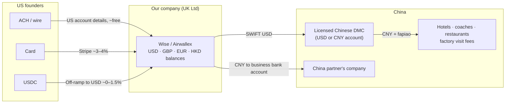

# Company structure & payments

How to set up the business behind the Silicon Valley → Shenzhen robotics trips so that we can take money from US founders, pay vendors in China in CNY, and keep tax and admin low.

> Researched October 2026. This is a starting point for planning, not legal or tax advice. Book a one-hour call with a UK accountant before the first payment comes in, and another if anyone's residency changes.

---

## TL;DR

1. **Use a UK Ltd for trip #1, not a Hong Kong company.** The lead founder is UK-based, so HMRC treats any company they run from the UK as UK tax resident, wherever it's incorporated. A HK company would pay UK tax anyway *and* cost HK audit and company-secretary fees on top.
2. **Collect money with a multi-currency fintech account** (Wise Business or Airwallex). Both give a UK company US bank details, so Americans can pay by ACH or wire as if it were a domestic transfer. Use cards (Stripe) as a convenience option, not the main rail. On a ~$5k ticket, card fees are about $150–250 per person, while ACH is close to free.
3. **Pay China through one licensed Chinese travel agency (DMC) in USD.** Don't pay dozens of hotels, coaches and restaurants yourself. The DMC pays them in CNY and gives us fapiao. The China partner's company invoices separately for its own fees.
4. **Stablecoins (USDC) are fine to *receive* from crypto-native founders. Never use them to pay anyone in mainland China**, which reaffirmed its crypto ban in February 2026.
5. **Revisit Hong Kong if the lead founder moves out of the UK for the gap year** and the trips become a recurring business. Then HK's 8.25% rate, or 0% on a successful offshore claim, becomes real. At trip-1 scale the HK saving is roughly cancelled by HK compliance costs anyway.
6. **The real risks aren't tax.** In order: (a) payment processors treating "travel" as high-risk, (b) California's Seller of Travel law, (c) US visitor-visa limits on working while in the US, (d) China travel-agency rules. See [Compliance checklist](#compliance-checklist).

---

## 1. Where the company should live

### The rule that decides it: "central management and control"

The UK treats a foreign-incorporated company as **UK tax resident if its strategic decisions are actually made in the UK**. Board minutes written in Hong Kong don't change that, because HMRC looks at where the decision-maker really is. The UK–Hong Kong double tax treaty settles dual residence by "place of effective management", which points to the same answer.

So **"register in HK to pay less tax" only works if the lead founder is not UK resident**, or if the company is genuinely run by someone outside the UK.

### Options compared

| | **UK Ltd** (recommended now) | **Hong Kong Ltd** | **US LLC / C-corp** |
|---|---|---|---|
| Setup | ~£100, online, about 1 day | ~US$1–2k via an agent, 1–2 weeks | $100s–$500 + registered agent |
| Annual admin | Accounts + CT600; no audit for small companies (~£500–1.5k/yr) | **Mandatory audit every year**, a company secretary based in HK, BR fee ~HK$2,350 (~US$2–4k/yr in total) | Form 5472 + pro forma 1120 every year if foreign-owned (**$25k penalty if missed**) |
| Corporate tax | 19% on profits ≤ £50k; 25% above £250k | 8.25% on first HK$2M, 16.5% above; **possibly 0%** via an offshore claim (profits earned in Shenzhen from US customers) | 0% federal if there's no US trade or business, but the UK may still tax it (see below) |
| Works while the lead founder is UK resident? | ✅ Yes, the natural fit | ⚠️ Becomes UK tax resident anyway, so you get both HK costs and UK tax | ⚠️ UK treats an LLC as a company, so you get the same residence problem plus a tax-classification mismatch |
| Banking / fintech | Easy: Wise, Airwallex, Revolut, Stripe UK | Traditional HK banks are hard for non-resident directors; Airwallex/Statrys/virtual banks are easier | Mercury/Stripe US are easy, but no real advantage over Wise/Airwallex US details |
| Credibility with US founders | Good | Fine | Best, but not needed for a trip |
| VAT/sales tax on a China trip | UK VAT margin scheme (TOMS) zero-rates the margin on travel outside the UK, so effectively no UK VAT | None | No US sales tax on travel packages |

**Why not a sole trader?** Unlimited personal liability for a group touring factories is a bad idea. Use a limited company.

**Why not a US entity?** We don't need it to get paid by Americans (Wise and Airwallex give US account details). It adds a $25k-penalty filing trap and UK tax mismatches, and it doesn't help with the B1/B2 issue. The exception is if the US partner wants to be the legal seller in their own US entity, with our company as a subcontractor. That's workable, but it puts all customer cash under their control. Only do it with a written agreement and real trust.

### What tax looks like (illustrative trip #1)

Assume 20 founders × $5,000 = **$100k revenue** (flights not included).

| Line | $ |
|---|---|
| Ground costs via DMC (hotels, coaches, meals, guides, venue fees) | −45,000 |
| US partner referral fee (10%) | −10,000 |
| China partner fee | −10,000 |
| Payment fees (mix of ACH + cards) | −2,000 |
| Insurance, legal, misc | −5,000 |
| **Profit** | **~28,000 (~£21k)** |

- **UK Ltd:** 19% corporation tax ≈ £4k. Extracting the rest as salary and dividends is cheap if the lead founder's other income that tax year is low, because the £12,570 personal allowance and £500 dividend allowance apply first, then dividends at 10.75% in the basic band (2026/27).
- **HK Ltd with the lead founder genuinely non-UK resident:** 8.25% ≈ $2.3k, or $0 with an offshore claim. But HK audit, secretary and fees run about $2–4k a year.
- **Conclusion:** at this scale the HK "saving" is about the same as the HK overhead. Optimise for simplicity now. Re-evaluate at roughly $500k+/year revenue or when residency changes.

### US tax exposure (for any non-US company)

- The trip happens in China, so the service income is **foreign-source** for US purposes. A UK company with no US "permanent establishment" pays no US federal tax (US–UK treaty).
- To keep it that way, the **US partner should be an independent referral agent.** They're paid commission and don't sign contracts on our behalf. Customers accept *our* T&Cs and pay *our* company directly.

### Partner economics (trip #1)

- Don't hand out equity yet. Use simple written agreements:
  - **US partner:** referral/recruiting fee, either % of ticket revenue or a fixed fee per head. Paid after the trip runs, or after the refund window closes.
  - **China partner:** service fee invoiced by their Chinese company (with fapiao), or folded into the DMC contract.
- If this becomes a recurring business, convert to a shareholders' agreement with vesting.
- Keep this company **separate from any future YC startup.** YC will want a clean Delaware C-corp, not one carrying trip liabilities.

---

## 2. Money flow

### Collecting from Americans

| Rail | Cost on $5,000 | Pros | Cons |
|---|---|---|---|
| **ACH / wire to Wise or Airwallex USD details** | ~$0–10 | Cheapest. No chargebacks. Founders can pay from their startup's Mercury/Brex account and expense it. | Slightly more friction; we have to send invoices |
| **Card via Stripe** (UK account) | ~$160–200 | Familiar, instant | Stripe lists travel reservation services as high-risk, so expect a review, possibly a rolling reserve, and chargeback risk on prepaid trips |
| **Luma ticket** | Stripe fees + **5% platform fee** on the free plan (0% on Luma Plus, $59/mo) | What comparable trips use; good for discovery | 5% of $5,000 is $250 a head. Use Luma for free info sessions and applications, and take the real payment by invoice or Stripe |
| **USDC** (direct wallet on Base/Solana, or Stripe's stablecoin acceptance at ~1.5%) | ~$0–75 | Instant, global, no chargebacks; SF founders like it | Needs an off-ramp (Coinbase Business, Kraken, Bridge); extra bookkeeping; some banks dislike crypto inflows. Check whether Stripe's stablecoin acceptance is open to a UK account before relying on it |

**Recommended default:** an invoice with ACH/wire details as the main option, a Stripe card link as a fallback, and USDC on request. Charge a deposit (e.g. 30%) on acceptance, with the balance due about 45 days before departure.

**Before onboarding Stripe:** describe the business accurately ("group business-study trip; ground services delivered by a licensed partner") and ask about travel approval up front. A frozen account a month before departure is the worst-case scenario.

### Paying China

- **Main route: pay a licensed Chinese DMC / inbound travel agency in USD by SWIFT.** Inbound tourism counts as a service export for them, so receiving USD is routine. They convert, pay every vendor locally in CNY, and issue fapiao. Get the quote in **USD**, or lock the CNY rate when we sign, so FX risk is fixed early.
- **China partner's own fee:** send CNY to their **company** bank account via Wise (local bank account rail for business recipients) or SWIFT. Airwallex's *local* CNY payouts are limited to e-commerce and goods-export use cases, so use SWIFT through Airwallex for services.
- **Small payments to individuals** (freelance guide, photographer): Wise can send CNY to an individual's Alipay (up to ¥50k per transfer) or UnionPay card. Keep receipts. Prefer routing these through the DMC.
- **On-the-ground incidentals:** foreign Visa/Mastercard cards now link to Alipay and WeChat Pay. Give the trip lead a company card and a small float.
- **Never pay mainland vendors in USDT or other stablecoins.** PBOC Notice No. 42 (Feb 2026) reaffirmed that virtual-currency business in mainland China is illegal financial activity, and Chinese bank accounts linked to crypto OTC trades get frozen.

### Hold customer money carefully

- Don't spend deposits before the trip. Keep them in a separate balance (Wise and Airwallex both support sub-balances or "jars"). California's Seller of Travel law may require a trust account anyway (see below).
- Keep USD in USD until the DMC payment is due. There's no need to convert to GBP.

---

## Compliance checklist

| # | Item | Why it matters | Action |
|---|---|---|---|
| 1 | **US visitor visa (B1/B2)** | B1/B2 allows meetings, networking and negotiating. It doesn't allow hands-on productive work in the US. Owning a foreign company is fine; running US sales and events from inside the US is a grey area that can hurt future visas. | Keep the company, its decision-making and its profits outside the US. The US partner hosts the SF events and does recruiting. The lead founder's US visits stay "business visitor" in nature. Do a 30-minute consult with a US immigration lawyer if the lead founder will spend extended time in the US. |
| 2 | **California Seller of Travel** | It covers anyone selling or advertising air/sea transport, or land transport where the total charge is over $300, to people in California, including sellers outside the state. Our package includes coaches in Shenzhen. | Assume it applies. Register with the CA Attorney General at least 10 days before advertising, set up the required trust account or bond, and show the CST number on the website (tell the website partner). |
| 3 | **China travel-agency rules** | Organised tourist groups are meant to be received by licensed Chinese travel agencies. Business visits to factories, arranged by the companies themselves, are a different track. | Book hotels, coaches and guides through a licensed DMC. Frame factory visits as business meetings arranged by the China partner. |
| 4 | **Traveller visas** | US citizens aren't on China's 30-day visa-free list, but they *can* use the **240-hour visa-free transit** if they arrive from one country and leave to a different country or region. Hong Kong counts as different. | Design the route around it: e.g. **fly US → Shenzhen (or Guangzhou/Shanghai), end the trip in Hong Kong, fly HK → US.** HK → Shenzhen → HK does *not* qualify. Anyone else needs an L or M visa. |
| 5 | **Terms & conditions** | They're our main protection against chargebacks and disputes. | Cover deposit, refund schedule, force majeure, itinerary changes, photo rules at factories (many ban photos), assumption of risk, and a liability waiver. |
| 6 | **Insurance** | People will be walking around factory floors. | Get tour-operator or event liability cover for the company and require travellers to hold their own travel and medical insurance. |
| 7 | **Lead founder's UK immigration status** (if applicable) | Some UK visas restrict self-employment or working for your own company. | Check before incorporating. The Graduate route allows self-employment; Student and some sponsored visas don't. |
| 8 | **UK Companies House identity verification** | Now mandatory for directors. | Do it when incorporating. |

---

## Next steps

- [ ] Lead founder confirms UK tax residency for 2026/27 and gap-year plans (this decides UK Ltd vs HK).
- [ ] Incorporate the UK Ltd and complete Companies House ID verification.
- [ ] Open Wise Business and/or Airwallex and get USD account details.
- [ ] Apply for Stripe (UK), flagging the travel use case up front.
- [ ] Shortlist two or three licensed Shenzhen DMCs and get USD quotes for a 5-day, 20-person program.
- [ ] Sign the US partner (referral agreement) and China partner (services agreement).
- [ ] Check California Seller of Travel registration; add the CST number to the website.
- [ ] Draft T&Cs, refund policy and waiver; get an insurance quote.
- [ ] Book a one-hour UK accountant call to confirm the CT, dividend and TOMS treatment.
- [ ] Set the itinerary to work with 240-hour transit (enter mainland from the US, exit via Hong Kong).

---

## Sources

- UK company residence / central management and control: [Macfarlanes](https://macfarlanes.com/media/1667/corporate-residence-central-management-and-control.pdf), [Mishcon de Reya](https://www.mishcon.com/news/corporate-tax-residence-the-risk-of-uk-involvement-in-non-uk-company-decisions), [Charles Russell Speechlys](https://www.charlesrussellspeechlys.com/en/insights/expert-insights/global-markets/2022/have-you-packed-your-company-with-you/)
- UK corporation tax 2026/27: [FreeAgent](https://www.freeagent.com/rates/corporation-tax/); dividend tax 2026/27: [Clive Owen](https://www.cliveowen.com/taxation-of-dividends-2026-27-uk/)
- UK VAT margin scheme: [HMRC VAT Notice 709/5](https://gov.uk/guidance/tour-operators-margin-scheme-for-vat-notice-7095)
- HK profits tax, audit, offshore claims: [Statrys](https://statrys.com/guides/hong-kong/hong-kong-accounting-standards/small-business-accounting), [Uppersetup](https://uppersetup.com/en/article/the-offshore-profits-claim-in-hong-kong-how-the-territorial), [ACCA](https://www.accaglobal.com/learning-and-events/tax-and-tax-management/hk-offshore-claim)
- Form 5472 for foreign-owned US LLCs: [Zenind](https://www.zenind.com/help/post/foreign-owned-single-member-llc-filing-guide-form-5472-pro-forma-1120-deadlines-and-penalties)
- Stripe restricted businesses: [Stripe FAQ](https://support.stripe.com/questions/prohibited-and-restricted-business-list-faqs); Stripe stablecoin acceptance: [The Block](https://www.theblock.co/post/320404/stripe-crypto-payments)
- Luma fees and Stripe requirement: [Luma vs Eventbrite](https://help.luma.com/p/luma-vs-eventbrite), [Luma payment countries](https://help.luma.com/p/what-countries-can-i-accept-payments-from)
- Airwallex CNY payouts: [Airwallex docs: China](https://www.airwallex.com/docs/payouts/payout-network/china); Wise CNY: [Wise help](https://www.wise.com/help/articles/2955298/cny-transfers), [Wise → Alipay](https://wise.com/help/articles/2kTApouGnjRj6JM1yduMIL/sending-cny-to-an-alipay-user)
- China crypto stance (Notice No. 42, Feb 2026): [Charltons](https://www.charltonslaw.com/chinas-regulatory-position-on-virtual-currencies-and-rwa/), [CryptoSlate](https://cryptoslate.com/crypto-laws/china-pboc-virtual-currency-rwa-notice-no-42-2026/)
- HK stablecoin licences (Apr 2026): [Charltons](https://www.charltonslaw.com/hkma-issues-first-stablecoin-issuer-licences/)
- California Seller of Travel: [CA AG statute page](https://oag.ca.gov/travel/statute), [Travel Law](https://travellaw.com/seller-of-travel-registration/california-seller-of-travel-registration/), [FindLaw §17550.1](https://codes.findlaw.com/ca/business-and-professions-code/bpc-sect-17550-1/)
- B1/B2 and remote work: [Lippes Mathias](https://www.lippes.com/insights/can-foreign-nationals-work-remotely-in-the-u-s-2914)
- 240-hour visa-free transit: [Shanghai government](https://english.shanghai.gov.cn/en-Individuals-ImmigrationandVisas-Visa-freepolicies/20260709/d70a1231ba4641ff9a024e53751ad480.html), [Wander in China (US citizens)](https://wanderinchina.com/survival-guide/visa/united-states/)
- China group-tour agency rules: [China Briefing](https://www.china-briefing.com/news/china-fully-allows-visa-free-entry-for-foreign-tourist-groups-on-cruise-ships/), [NIA](https://en.nia.gov.cn/n147418/n147463/c156078/content.html)
- Comparable trip (Future Factory, 24 founders / 15 factories / 5 days): [Cohort 1 recap](https://cohort0.notion.site/Future-Factory-Cohort-1-Recap-303abd5b834080db9b41ccab092c8c8a)
