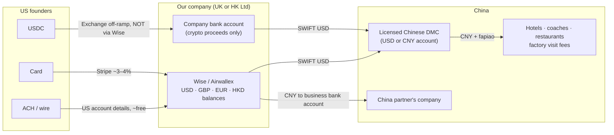

# Company structure & payments

How to set up the business behind the Silicon Valley → Shenzhen robotics trips so that we can take money from US founders, pay vendors in China in CNY, and keep tax and admin low.

> Researched October 2026. This is a starting point for planning, not legal or tax advice. Book a one-hour call with a UK accountant (and a Hong Kong one if you go that route) before the first payment comes in, and another if anyone's residency changes.

---

## TL;DR

1. **Where you live decides your tax, not where you register the company.** A company is taxed where it's actually run from, and you're taxed where you live. Registering in Hong Kong, the UAE or Ireland while you live in the UK changes nothing except adding fees.
2. **At ~$500k/yr profit, that residency decision is worth ~$190k a year.** If you live in the UK and pay all the profit out, about **51%** goes to tax. Living in Hong Kong it's about **12%**, and in the UAE about **7%**. That only works if you genuinely live there.
3. **Recommendation:** if the lead founder will run the China operations full-time and can leave the UK properly, **live in Hong Kong and use a HK Ltd.** If they stay in the UK, **use a UK Ltd**, because nothing set up elsewhere helps. See [scenarios](#13-recommendation-by-scenario).
4. **Skip Ireland, offshore shells, and the UAE** unless the lead founder actually wants to live in Dubai.
5. **Taking payment:** ACH/wire into Wise or Airwallex is the main option. Stablecoins (USDC) are fine to accept, but **Wise rejects money coming from Coinbase or Binance** (business accounts included), so stablecoin money needs a separate route into a bank (an "off-ramp").
6. **Pay China through one licensed Chinese travel agency (DMC) in USD.** Never pay mainland vendors in stablecoins. China reaffirmed its crypto ban in February 2026.
7. **Non-tax risks** to handle in parallel: payment processors treating travel as high-risk, California's Seller of Travel law, US visitor-visa limits, and China travel-agency rules. See [Compliance checklist](#compliance-checklist).

---

## 1. Where the company should live

### 1.1 The two rules that decide your tax

**The company is taxed where it's run from.** The UK treats a foreign company as UK tax resident if its strategic decisions are actually made in the UK ("central management and control"). Board minutes written abroad don't change that. The UK–Hong Kong tax treaty settles dual residence by "place of effective management", which points to the same answer. Hong Kong taxes profits from business carried on in Hong Kong, and the UAE and Ireland expect real local substance too. One more trap: **a UK-incorporated company stays UK tax resident forever**, even after you leave.

**You are taxed where you're resident.** The UK uses the Statutory Residence Test (SRT):
- **183+ days in the UK** in a tax year (6 April – 5 April) makes you automatically UK resident.
- **Fewer days doesn't guarantee non-residence.** Ties to the UK (accommodation, work, family, time spent there in earlier years) can still make you resident at 46–182 days.
- **The clean exit is the "full-time work overseas" test.** Across the whole tax year you average 35+ hours a week working abroad, spend **fewer than 91 days** in the UK, and work more than 3 hours on **fewer than 31** of those days. Running this business full-time from Hong Kong or China counts as work.
- **Split-year treatment** can make the year you leave UK-resident only up to your departure date.
- **Temporary non-residence:** if you come back to the UK within 5 years, dividends you took while abroad *out of profits earned before you left* get taxed when you return. Profits earned after you leave are generally outside this.

### 1.2 What ~$500k profit costs in each place

Assumptions: $500k is company profit **after** paying partners. In the UK case, everything is paid out as dividends in one tax year. £1 = $1.33.

| Where the lead founder lives (company run from there) | Company tax | Personal tax on dividends | Total | You keep |
|---|---|---|---|---|
| **UK** (UK Ltd, or *any* company run from the UK) | 25% ≈ £94k | ≈ £97k (10.75% / 35.75% / 39.35% bands) | **~51%** | **~$246k** |
| **Hong Kong** (HK Ltd) | 8.25% on first HK$2M, 16.5% above ≈ $61k | 0% (HK doesn't tax dividends) | **~12%** | **~$439k** |
| **UAE** (UAE company) | 0% up to AED 375k, 9% above ≈ $36k | 0% | **~7%** | **~$464k**, less ~$10–15k/yr licence, visa and audit |
| **Singapore** | ~17% with partial exemptions ≈ $72k | 0% | **~14%** | **~$428k** |
| **Ireland** (Irish resident) | 12.5% ≈ $62k | ~52% (income tax + USC + PRSI) | **~58%** | **~$210k** |

The UK figure falls if you leave profit in the company or pay dividends gradually across tax years. The tax-free part of the HK figure is the dividends. A HK "offshore claim" (0% company tax) is possible, but if you run things from a HK office the tax office will probably treat the profit as earned in Hong Kong, so budget for ~12%.

### 1.3 Recommendation by scenario

**A. The lead founder runs China operations full-time and can leave the UK by ~April 2027: Hong Kong.**
- **Why not the UAE:** the job is in Shenzhen, which is 30 minutes from Hong Kong. To be UAE tax resident you'd need to actually live in the UAE (about 183 days a year), which doesn't fit running factory visits in Shenzhen.
- **Visa:** Hong Kong's Top Talent Pass Scheme, Category C, is for people with a bachelor's degree from a listed top university (Cambridge is on the list) earned in the last 5 years, with under 3 years' work experience. Sources disagree on whether Category C has a 10,000/yr quota, so check with the Immigration Department.
- **Banking:** Airwallex HK or Statrys from day one. Traditional HK banks get much easier once you're physically resident.
- **Watch your nights in mainland China:**
  - If you provide services in the mainland for more than **183 days in any 12 months**, the HK company risks a taxable presence there (25% mainland corporate tax on the attributable profit).
  - **183 days in a calendar year** in the mainland can make you personally tax-resident in China.
  - So live in Hong Kong, do day trips across the border, and let the China partner's company deliver the on-the-ground services.
- **If you hold a PRC passport with a mainland hukou:** China may treat you as tax-resident by domicile regardless of day counts, and it has been stepping up enforcement on residents' overseas income. Get a China tax view before relying on Hong Kong's 0% on dividends.

**B. The lead founder stays UK resident: UK Ltd.** A company anywhere else would just be UK-taxed with extra fees. Legal ways to reduce the bill:
- Pay partners their share as fees, so it's taxed in their hands, not yours.
- Leave profit in the company and pay dividends gradually across tax years to use the lower bands.
- Make employer pension contributions. They're deductible for the company, within the £60k annual allowance (lower for very high earners).
- Register for VAT once the margin passes £90k. The margin scheme (TOMS) zero-rates the margin on trips outside the UK, so you pay no VAT and can reclaim VAT on UK overheads.

**C. Not decided yet, or trip 1 happens before the move.** There are two workable paths:
1. **UK Ltd for trip 1, a new HK Ltd for every trip after the move.** Each trip is a separate sale, so there's little to migrate. Pay out the UK-era profits while still UK resident, so the temporary non-residence rule can't bite later. Then wind the UK company down.
2. **HK Ltd from day one.** While you're UK resident it's UK-taxed, and you also pay for the HK audit plus UK filings (~$3–6k/yr extra). When you move it becomes HK-only, with no new bank accounts, Stripe account or contracts. You'd notify HMRC when the company leaves and pay any exit charge, which is small for a young services company.

Choose path 2 if you're fairly sure you'll move within the year. Otherwise choose path 1.

### 1.4 Why not the others

- **UAE:** the lowest number on paper, but you'd have to live there. The free-zone 0% rate only covers listed "qualifying activities" (manufacturing, trading, logistics, fund management and similar). Organising trips doesn't appear to be one of them, so 9% applies above AED 375k; confirm with a UAE adviser. Small-business relief only covers tax periods ending by 31 Dec 2026. Opening bank accounts for new companies is slow.
- **Ireland:** the 12.5% rate only applies if the company is genuinely run from Ireland, and it needs an EEA-resident director or a bond. Dividends to an Irish resident are taxed at ~52%, which is worse than the UK once you take the money out.
- **Offshore shells (BVI, Cayman, "0% LLC" setups):** banks and Stripe treat them as high-risk. The company is taxed where it's run anyway, and UK rules for foreign companies controlled from the UK (CFC rules) apply if you're UK resident.
- **US entity:** we don't need one to get paid by Americans, because Wise and Airwallex give US account details. It adds a $25k-penalty annual filing (Form 5472). The only exception is if the US partner wants to be the legal seller in their own US entity, with our company as a subcontractor. That puts all customer cash under their control, so only do it with a written agreement and real trust.
- **Sole trader:** unlimited personal liability for a group touring factories. Use a limited company.

### 1.5 US partner and US tax

- **The split already helps:** the US partner sells and the lead founder runs China. That fits the B1/B2 position, so keep it that way.
- **Pay the US partner a commission through a contract**, ideally to their own US entity, rather than giving them shares in the HK/UK company. A US person who owns 10%+ of a foreign company has to file Form 5471 and can owe US tax on their share of its profits each year. That's painful and unnecessary.
- **Customers contract with our company online.** The partner doesn't sign contracts on our behalf and there's no US office.
- **US tax:** the trip itself happens in China, so the income is foreign-source for US purposes. A UK company also has US–UK treaty protection. Hong Kong has **no** US tax treaty, so for a HK company these rules matter more.

### 1.6 Partner economics

- Don't hand out equity yet. Use simple written agreements:
  - **US partner:** referral/recruiting fee, either % of ticket revenue or a fixed fee per head. Paid after the trip runs, or after the refund window closes.
  - **China partner:** service fee invoiced by their Chinese company (with fapiao), or folded into the DMC contract.
- If this becomes a recurring business, convert to a shareholders' agreement with vesting.
- Keep this company **separate from any future YC startup.** YC will want a clean Delaware C-corp, not one carrying trip liabilities.

---

## 2. Money flow

### Collecting from Americans

| Rail | Cost on $5,000 | Pros | Cons |
|---|---|---|---|
| **ACH / wire to Wise or Airwallex USD details** | ~$0–10 | Cheapest. No chargebacks. Founders can pay from their startup's Mercury/Brex account and expense it. | Slightly more friction; we have to send invoices |
| **Card via Stripe** (UK account) | ~$160–200 | Familiar, instant | Stripe lists travel reservation services as high-risk, so expect a review, possibly a rolling reserve, and chargeback risk on prepaid trips |
| **Luma ticket** | Stripe fees + **5% platform fee** on the free plan (0% on Luma Plus, $59/mo) | What comparable trips use; good for discovery | 5% of $5,000 is $250 a head. Use Luma for free info sessions and applications, and take the real payment by invoice or Stripe |
| **USDC** (direct to a company wallet on Base/Solana) | ~$0–30 (network fee is cents; the exchange's USDC→USD is often 1:1; a bank wire out is ~$25) | Instant, global, no chargebacks; SF founders like it | **Not zero-friction.** Wise rejects payments from Coinbase and Binance (business accounts too) and may close the account, so the money needs a separate route into a bank (see below). Same tax as any other revenue. Extra bookkeeping (match each invoice to its transaction ID) |
| **USDC via Stripe's stablecoin acceptance** | ~$75 (1.5%) | Customer pays USDC, we receive USD in Stripe, so no off-ramp needed | Originally US businesses only; check it's open to a UK or HK account |

**Recommended default:** an invoice with ACH/wire details as the main option, a Stripe card link as a fallback, and USDC on request.

**If you accept stablecoins:**
- **Accept USDC only, not USDT.** USDC has the cleanest 1:1 conversion to dollars.
- **Convert it on an exchange the company is onboarded with,** not a personal account:
  - Coinbase converts USDC→USD 1:1, fee-free up to $5M every 30 days. ACH out is free and a wire is about $25. Check that it onboards a UK or HK company.
  - A HK company can use an SFC-licensed exchange (HashKey, OSL) that pays out to a Hong Kong bank account.
- **Withdraw to a company bank account that's happy with crypto-sourced funds,** never into Wise. Keep the invoice ↔ transaction-ID trail for the accountant and the bank.
- **Treat it as a convenience for crypto-native founders, not a tax or fee hack.** The ACH rail is just as cheap. Charge a deposit (e.g. 30%) on acceptance, with the balance due about 45 days before departure.

**Before onboarding Stripe:** describe the business accurately ("group business-study trip; ground services delivered by a licensed partner") and ask about travel approval up front. A frozen account a month before departure is the worst-case scenario.

### Paying China

- **Main route: pay a licensed Chinese DMC / inbound travel agency in USD by SWIFT.** Inbound tourism counts as a service export for them, so receiving USD is routine. They convert, pay every vendor locally in CNY, and issue fapiao. Get the quote in **USD**, or lock the CNY rate when we sign, so FX risk is fixed early.
- **China partner's own fee:** send CNY to their **company** bank account via Wise (local bank account rail for business recipients) or SWIFT. Airwallex's *local* CNY payouts are limited to e-commerce and goods-export use cases, so use SWIFT through Airwallex for services.
- **Small payments to individuals** (freelance guide, photographer): Wise can send CNY to an individual's Alipay (up to ¥50k per transfer) or UnionPay card. Keep receipts. Prefer routing these through the DMC.
- **On-the-ground incidentals:** foreign Visa/Mastercard cards now link to Alipay and WeChat Pay. Give the trip lead a company card and a small float.
- **Never pay mainland vendors in USDT or other stablecoins.** PBOC Notice No. 42 (Feb 2026) reaffirmed that virtual-currency business in mainland China is illegal financial activity, and Chinese bank accounts linked to crypto OTC trades get frozen.

### Hold customer money carefully

- Don't spend deposits before the trip. Keep them in a separate balance (Wise and Airwallex both support sub-balances or "jars"). California's Seller of Travel law may require a trust account anyway (see below).
- Keep USD in USD until the DMC payment is due. There's no need to convert to GBP or HKD.

---

## Compliance checklist

| # | Item | Why it matters | Action |
|---|---|---|---|
| 1 | **US visitor visa (B1/B2)** | B1/B2 allows meetings, networking and negotiating. It doesn't allow hands-on productive work in the US. Owning a foreign company is fine; running US sales and events from inside the US is a grey area that can hurt future visas. | Keep the company, its decision-making and its profits outside the US. The US partner does the selling, hosts the SF events and does recruiting. The lead founder's role is China operations, which helps. US visits stay "business visitor" in nature. Do a 30-minute consult with a US immigration lawyer if the lead founder will spend extended time in the US. |
| 2 | **California Seller of Travel** | It covers anyone selling or advertising air/sea transport, or land transport where the total charge is over $300, to people in California, including sellers outside the state. Our package includes coaches in Shenzhen. | Assume it applies. Register with the CA Attorney General at least 10 days before advertising, set up the required trust account or bond, and show the CST number on the website (tell the website partner). |
| 3 | **China travel-agency rules** | Organised tourist groups are meant to be received by licensed Chinese travel agencies. Business visits to factories, arranged by the companies themselves, are a different track. | Book hotels, coaches and guides through a licensed DMC. Frame factory visits as business meetings arranged by the China partner. |
| 4 | **Traveller visas** | US citizens aren't on China's 30-day visa-free list, but they *can* use the **240-hour visa-free transit** if they arrive from one country and leave to a different country or region. Hong Kong counts as different. | Design the route around it: e.g. **fly US → Shenzhen (or Guangzhou/Shanghai), end the trip in Hong Kong, fly HK → US.** HK → Shenzhen → HK does *not* qualify. Anyone else needs an L or M visa. |
| 5 | **Terms & conditions** | They're our main protection against chargebacks and disputes. | Cover deposit, refund schedule, force majeure, itinerary changes, photo rules at factories (many ban photos), assumption of risk, and a liability waiver. |
| 6 | **Insurance** | People will be walking around factory floors. | Get tour-operator or event liability cover for the company and require travellers to hold their own travel and medical insurance. |
| 7 | **Lead founder's UK immigration status** (if applicable) | Some UK visas restrict self-employment or working for your own company. | Check before incorporating. The Graduate route allows self-employment; Student and some sponsored visas don't. |
| 8 | **UK Companies House identity verification** | Now mandatory for directors. | Do it when incorporating (UK Ltd only). |
| 9 | **Lead founder's tax residency** | It drives ~$190k/yr of tax at $500k profit (see §1.2). | Decide 2027/28 plans by ~March 2027. If leaving, plan for the full-time-work-overseas test (<91 UK days, <31 UK workdays) and keep a day-count log for the UK *and* mainland China. |

---

## Next steps

- [ ] **Lead founder decides where they'll live for 2027/28** (this decides UK Ltd vs HK Ltd, see §1.3).
- [ ] If Hong Kong: check Top Talent Pass Category C eligibility and quota, and get a HK accountant quote (audit + company secretary).
- [ ] If the lead founder holds a PRC passport: get a China tax view on residency and domicile.
- [ ] Incorporate the chosen company (UK: Companies House ID verification; HK: agent + company secretary).
- [ ] Open Wise Business and/or Airwallex and get USD account details.
- [ ] Apply for Stripe (UK or HK), flagging the travel use case up front.
- [ ] If accepting USDC: onboard the company with an exchange that pays out to a non-Wise bank account.
- [ ] Shortlist two or three licensed Shenzhen DMCs and get USD quotes for a 5-day, 20-person program.
- [ ] Sign the US partner (referral agreement) and China partner (services agreement).
- [ ] Check California Seller of Travel registration; add the CST number to the website.
- [ ] Draft T&Cs, refund policy and waiver; get an insurance quote.
- [ ] Book a one-hour UK accountant call to confirm residency (SRT, split year, temporary non-residence), CT, dividends and TOMS.
- [ ] Set the itinerary to work with 240-hour transit (enter mainland from the US, exit via Hong Kong).

---

## Sources

- UK company residence / central management and control: [Macfarlanes](https://macfarlanes.com/media/1667/corporate-residence-central-management-and-control.pdf), [Mishcon de Reya](https://www.mishcon.com/news/corporate-tax-residence-the-risk-of-uk-involvement-in-non-uk-company-decisions), [Charles Russell Speechlys](https://www.charlesrussellspeechlys.com/en/insights/expert-insights/global-markets/2022/have-you-packed-your-company-with-you/)
- UK corporation tax 2026/27: [FreeAgent](https://www.freeagent.com/rates/corporation-tax/); dividend tax 2026/27: [Clive Owen](https://www.cliveowen.com/taxation-of-dividends-2026-27-uk/)
- UK VAT margin scheme: [HMRC VAT Notice 709/5](https://gov.uk/guidance/tour-operators-margin-scheme-for-vat-notice-7095)
- HK profits tax, audit, offshore claims: [Statrys](https://statrys.com/guides/hong-kong/hong-kong-accounting-standards/small-business-accounting), [Uppersetup](https://uppersetup.com/en/article/the-offshore-profits-claim-in-hong-kong-how-the-territorial), [ACCA](https://www.accaglobal.com/learning-and-events/tax-and-tax-management/hk-offshore-claim)
- Form 5472 for foreign-owned US LLCs: [Zenind](https://www.zenind.com/help/post/foreign-owned-single-member-llc-filing-guide-form-5472-pro-forma-1120-deadlines-and-penalties)
- Stripe restricted businesses: [Stripe FAQ](https://support.stripe.com/questions/prohibited-and-restricted-business-list-faqs); Stripe stablecoin acceptance: [The Block](https://www.theblock.co/post/320404/stripe-crypto-payments)
- Luma fees and Stripe requirement: [Luma vs Eventbrite](https://help.luma.com/p/luma-vs-eventbrite), [Luma payment countries](https://help.luma.com/p/what-countries-can-i-accept-payments-from)
- Airwallex CNY payouts: [Airwallex docs: China](https://www.airwallex.com/docs/payouts/payout-network/china); Wise CNY: [Wise help](https://www.wise.com/help/articles/2955298/cny-transfers), [Wise → Alipay](https://wise.com/help/articles/2kTApouGnjRj6JM1yduMIL/sending-cny-to-an-alipay-user)
- China crypto stance (Notice No. 42, Feb 2026): [Charltons](https://www.charltonslaw.com/chinas-regulatory-position-on-virtual-currencies-and-rwa/), [CryptoSlate](https://cryptoslate.com/crypto-laws/china-pboc-virtual-currency-rwa-notice-no-42-2026/)
- Wise's crypto policy (no payments from Coinbase/Binance): [Wise help](https://wise.com/help/articles/2v3OMcg97Z7gObSifJbjsu/understanding-wises-position-on-cryptocurrency); Coinbase USDC→USD fees: [The Block](https://www.theblock.co/amp/post/274986/coinbase-to-charge-fees-on-usdc-to-usd-conversions-over-75-million), [Eco](https://eco.com/support/en/articles/15039728-convert-usdc-to-bank-account-fastest-routes-in-2026)
- UAE corporate tax and free zones: [Bar & Bench](https://www.barandbench.com/view-point/uae-corporate-tax-a-concise-overview), [Emerhub](https://emerhub.com/uae/uae-corporate-tax-calculator/)
- HK Top Talent Pass Scheme: [HK Government](https://www.info.gov.hk/gia/general/202512/28/P2025122400232.htm), [The Standard (eligible universities)](https://www.thestandard.com.hk/news/article/320266/Eligible-universities-for-HKs-talent-scheme-increase-to-200-effective-Jan-1), [The Standard (quota)](https://www.thestandard.com.hk/news/article/51553/Impressive-numbers-on-incoming-talent)
- HK stablecoin licences (Apr 2026): [Charltons](https://www.charltonslaw.com/hkma-issues-first-stablecoin-issuer-licences/)
- California Seller of Travel: [CA AG statute page](https://oag.ca.gov/travel/statute), [Travel Law](https://travellaw.com/seller-of-travel-registration/california-seller-of-travel-registration/), [FindLaw §17550.1](https://codes.findlaw.com/ca/business-and-professions-code/bpc-sect-17550-1/)
- B1/B2 and remote work: [Lippes Mathias](https://www.lippes.com/insights/can-foreign-nationals-work-remotely-in-the-u-s-2914)
- 240-hour visa-free transit: [Shanghai government](https://english.shanghai.gov.cn/en-Individuals-ImmigrationandVisas-Visa-freepolicies/20260709/d70a1231ba4641ff9a024e53751ad480.html), [Wander in China (US citizens)](https://wanderinchina.com/survival-guide/visa/united-states/)
- China group-tour agency rules: [China Briefing](https://www.china-briefing.com/news/china-fully-allows-visa-free-entry-for-foreign-tourist-groups-on-cruise-ships/), [NIA](https://en.nia.gov.cn/n147418/n147463/c156078/content.html)
- Comparable trip (Future Factory, 24 founders / 15 factories / 5 days): [Cohort 1 recap](https://cohort0.notion.site/Future-Factory-Cohort-1-Recap-303abd5b834080db9b41ccab092c8c8a)
